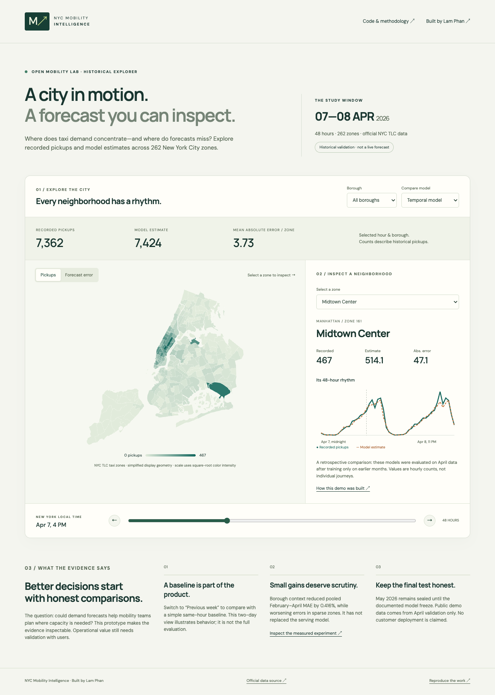

# NYC Mobility Intelligence

Explore where NYC yellow-taxi pickups concentrate and where forecasts miss.

[**Open the demo →**](https://gitlamhoang.github.io/nyc-mobility-intelligence/) · [How it works](docs/EXPLORER.md) · [Reproduce the research](docs/REPRODUCING.md)

The demo shows 262 zones across April 7–8, 2026. Compare three forecast methods, inspect a zone's hourly trace, and find the largest forecast errors. It runs from a small, committed snapshot with no login or API key.

[](https://gitlamhoang.github.io/nyc-mobility-intelligence/)

## Run the demo

Requires Node.js 24.12 or later and Git.

```bash
git clone https://github.com/gitLamHoang/nyc-mobility-intelligence.git
cd nyc-mobility-intelligence/web
npm ci
npm run dev
```

Open the local URL printed by Vite. No Python environment, raw trip download, or model file is needed.

1. Choose an hour and borough. Use **Previous day** / **Next day** below the timeline to compare the same New York hour across April 7–8 while keeping your filters.
2. Compare hourly estimates, absolute errors, and 48-hour MAE and average signed error in the zone panel; select a model there to update the map and trace. The daily comparison below shows each day's recorded/estimated totals and hourly MAE for that zone and model.
3. Switch the map to forecast error, or use **Largest forecast misses** to find the five largest absolute errors.
4. Find a zone by name or exact stable ID in the zone search, within the chosen borough, then select a result to inspect its 48-hour trace. Typing keeps the current view; **Clear search** restores all zones in that borough. You can also select a table row or map zone. The table states whether the forecast was under or over the recorded count. Use **Jump to largest miss** above the chart to inspect that zone’s greatest absolute error for the chosen model across these 48 hours (earliest hour for ties).
5. Use **Copy view link** or copy the browser address to share the selected hour, borough, model, map measure, and zone.
6. Use **Download selected hour CSV** for all filtered zones, or **Download zone 48-hour CSV** below the trace for the selected zone and model. Both include UTC time, stable zone IDs, recorded counts, estimates and errors.
7. Use **Reset view** to return to April 7 at 4 PM New York time, all boroughs, the temporal model, pickup shading and Midtown Center.

This is a historical validation demo. The two-day view illustrates behavior; it does not estimate full-study performance or provide live forecasts.

```bash
# From web/:
npm test
npm run build
npm run format:check
```

## What is in the repo

- `web/`: TypeScript, CSS, and SVG explorer. The data snapshot includes aggregated counts, forecasts, and simplified zone shapes.
- `src/nyc_mobility/`: Python acquisition, hourly aggregation, past-only features, models, evaluation, and local FastAPI inference.
- `sql/demo_summary.sql`: borough summaries checked against the demo export.
- `reports/` and `docs/`: measured results, source hashes, frozen protocols, and limitations. Raw trips and trained models stay outside Git.

The Python workflow and API setup are in [REPRODUCING.md](docs/REPRODUCING.md). The environment is pinned in `uv.lock`; preparation and training need downloads, several GB of RAM, and about 2 GB of data/artifact space.

## What the experiments show

The pipeline ingests 23,263,775 accepted pickups from December 2025 through May 2026. Development comparisons use February–April; May model evaluation remains sealed.

| Comparison | Measured result | Main limit |
|---|---|---|
| [Walk-forward validation](reports/WALK_FORWARD_REVIEW.md), 559,370 zone-hours | Squared-error boosting MAE 3.693 versus weekly baseline 5.104: 27.65% lower | Boosting is worse on sparse-zone MAE in every month |
| [Observation delay](reports/LATENCY_REVIEW.md) | Six-hour delay raises MAE 22.94% versus the matched zero-delay control | The study assumes historical counts; no live feed exists |
| [XGBoost depth 6](reports/XGBOOST_REVIEW.md) | MAE 0.76% lower than the matched temporal control | RMSE increases slightly; serving stays unchanged |
| [Borough context](reports/BOROUGH_REVIEW.md) | MAE 0.416% lower than the matched temporal control | Sparse-zone and zero-target errors worsen in every month |
| [Weather inputs](reports/WEATHER_ABLATION_REVIEW.md) | MAE worsens 2.32–2.74% across the two fixed delay variants | Historical weather availability and source quality remain unverified |

MAE means mean absolute error in pickups per zone-hour. Separate studies use matched controls, so their percentages must not be treated as one common ranking. Paired uncertainty analyses are linked from each review. These results describe the observed months and fitted models; they do not guarantee future performance.

## Data and forecast contract

At the start of hour `t`, predict pickups in that hour from completed observations through hour `t − 1`. All features use earlier observations or known calendar values. Evaluation advances with observed history.

The target is **recorded yellow-taxi pickups**, not all travel or unmet passenger demand. All 262 NYC Taxi Zones include zero-demand hours. Newark Airport and unknown/outside-NYC IDs are excluded. Yellow-taxi coverage is concentrated in Manhattan and airport activity.

| Partition | NYC local target times, end exclusive | Purpose |
|---|---|---|
| Initial training | Dec 1, 2025–Apr 1, 2026 | Fit parameters, with 168-hour warm-up |
| Initial validation | Apr 1–May 1, 2026 | Compare fixed baselines and classical models |
| Final test | May 1–Jun 1, 2026 | Sealed until the model-selection protocol is frozen |

The separate [walk-forward protocol](docs/WALK_FORWARD_PROTOCOL.md) uses expanding training histories for February, March, and April. Internally, hours are UTC; calendar features use `America/New_York`. The spring DST day has 23 hours. Lags of 24/168 hours measure elapsed time.

TLC publication delay prevents the public monthly records from supporting real-time use. Zero counts can also reflect reporting gaps. The local API is a prototype; operational observation ingestion, hosting, and monitoring remain open. User adoption and operational value have not been validated.

[Current state](PROJECT_STATE.md) · [Roadmap](ROADMAP.md) · [Changelog](CHANGELOG.md) · [Data sources and filtering](data/README.md)

## Sources and license

Data comes from [NYC TLC Trip Record Data](https://www.nyc.gov/site/tlc/about/tlc-trip-record-data.page) and official Taxi Zone sources. TLC does not guarantee vendor-submitted record accuracy. Exact source hashes, download times, and sizes are in [the manifest](reports/data_manifest.json).

Source code uses the [MIT license](LICENSE). Third-party data retains its own terms. Six months do not cover a full annual cycle; reported patterns are descriptive, not causal.
